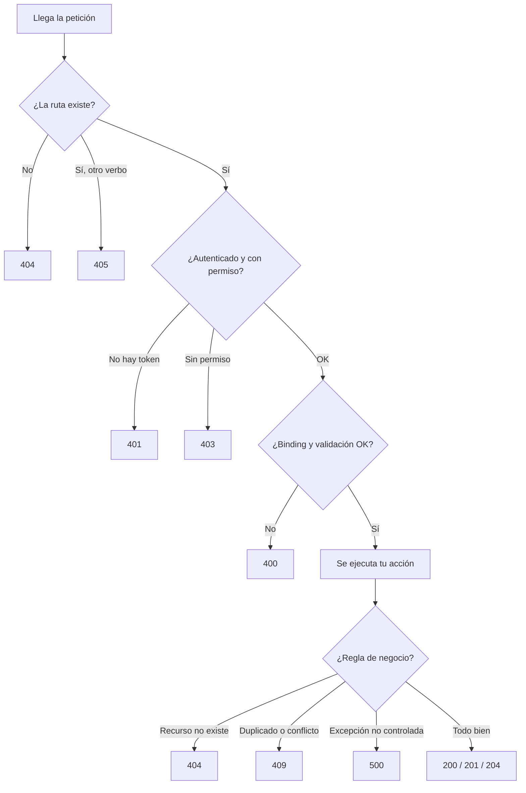

# Códigos HTTP en la API

## Regla base

| Familia | Quién falló | Pregunta que responde |
|---|---|---|
| **2xx** | Nadie | ¿Salió bien? |
| **4xx** | El **cliente** | ¿Pidió algo mal, que no existe o que no puede? |
| **5xx** | El **servidor** | ¿Falló algo de mi lado aunque el cliente hizo todo bien? |

Criterio práctico: si el fallo se arregla cambiando **lo que manda el cliente**, es 4xx. Si el cliente hizo todo bien y igual falla, es 5xx.

---

## Diferencias entre los códigos más comunes

**Analogía:** una tienda física.

| Código | Significa | En la tienda | En esta API |
|---|---|---|---|
| **400** Bad Request | La petición está mal formada o es inválida | Pides algo ilegible o imposible de procesar | JSON roto, `Price` negativo, nombre vacío |
| **401** Unauthorized | No sé quién eres | No traes credencial | Petición sin token |
| **403** Forbidden | Sé quién eres, pero no puedes | Traes credencial, pero no eres empleado | Cliente normal intenta crear un producto |
| **404** Not Found | Ese recurso no existe | Pides un artículo que no está en el catálogo | `GET /api/products/9999` |
| **405** Method Not Allowed | La ruta existe, pero no con ese verbo | La puerta existe, pero no se entra por ahí | `GET` a una ruta que solo acepta `PATCH` |
| **409** Conflict | Choca con el estado actual | Quieres registrar algo que ya está registrado | Categoría o SKU duplicado |
| **500** Internal Server Error | El servidor falló | Se cayó el sistema de la tienda | BD caída, bug, excepción no controlada |

**400 vs 404:** el 400 dice que la **petición** está mal. El 404 dice que la petición está bien, pero el **recurso** no existe.

**401 vs 403:** 401 es "no te identificaste". 403 es "te identificaste, pero no tienes permiso".

---

## Cómo deducir qué códigos devuelve un endpoint

No se adivinan. Se deducen con este método:

### 1. Cada `return` de tu acción es un código

```csharp
public IActionResult GetCategory(int id)
{
    var category = _repo.GetCategory(id);
    if (category == null) return NotFound(...);   // 404
    return Ok(dto);                               // 200
}
```

### 2. Códigos que NO escribes tú pero pueden pasar

| Código | Quién lo genera | Cuándo |
|---|---|---|
| **400** | `[ApiController]` | Body inválido, JSON roto o falla una validación de DataAnnotations (`[Required]`, `[Range]`) |
| **401** | Middleware de autenticación | Endpoint con `[Authorize]` y sin token |
| **403** | Middleware de autorización | Hay token, pero el rol no alcanza |
| **404** | Routing | La URL no coincide con ninguna ruta (incluye `{id:int}` con un valor no entero) |
| **405** | Routing | La ruta existe, pero con otro verbo |
| **415** | MVC | `Content-Type` que no es JSON |
| **500** | El framework | Excepción no controlada |

### 3. Códigos habituales según la operación

| Operación | Códigos habituales |
|---|---|
| GET lista | 200 |
| GET por id | 200, 404 |
| POST (crear) | 201, 400, 409 |
| PUT / PATCH (editar) | 204 o 200, 400, 404, 409 |
| DELETE | 204, 404, 409 |

### 4. Preguntas por endpoint

| Pregunta | Si es sí… |
|---|---|
| ¿Busco algo por id? | 404 |
| ¿Recibo datos del cliente? | 400 |
| ¿Hay una regla de negocio que puede rechazar? | 409 o 422. Ejemplo: stock insuficiente. |
| ¿Hay restricción de unicidad? | 409 |
| ¿Hay una FK que el cliente manda? | Un `CategoryId` inexistente debería ser 400. Si no lo validas, la BD lanza excepción y llega 500. |
| ¿Borrar rompe relaciones? | 409 |
| ¿Está protegido? | 401 y 403 |

### 5. Probar con casos malos a propósito

Id inexistente, body vacío, valores duplicados, campos fuera de rango. Lo que no previste aparece ahí.

---

## Flujo: dónde se corta una petición



Los códigos de la parte de arriba (404, 405, 401, 403, 400) se generan **antes** de que tu método se ejecute.

---

## Un listado vacío NO es 404

| Petición | Respuesta correcta |
|---|---|
| `GET /api/products` y no hay productos | **200** con `[]` |
| `GET /api/products/99` y el 99 no existe | **404** |

El 404 significa "ese **recurso** no existe". La colección `/api/products` sí existe, solo está vacía.

**Analogía:** si entras a una tienda y no hay playeras, la tienda existe. No es que "la tienda no se encontró".

Excepción razonable: `GET /api/categories/99/products`. Si la categoría 99 no existe, 404 tiene sentido (el recurso padre no existe). Si existe y no tiene productos, 200 con `[]`.

---

## Qué documentar con `[ProducesResponseType]`

Es solo documentación (ver `aspnet-controllers.md`). La regla es documentar los códigos que **tu código realmente puede devolver**.

| Código | ¿Documentarlo? |
|---|---|
| Los que tienen un `return` explícito en tu acción | ✅ Sí |
| 400 automático de `[ApiController]` | ✅ Sí, si la acción recibe body o parámetros validables |
| 401 / 403 | Solo cuando el endpoint tenga `[Authorize]` |
| 500 | Solo si tú lo devuelves explícitamente (`StatusCode(500, ...)`). El 500 inesperado no se documenta: se **maneja** con un middleware global que devuelva `ProblemDetails`. |

### ⚠️ Error que cometí: declarar códigos imposibles

```csharp
[HttpGet]
[ProducesResponseType(StatusCodes.Status403Forbidden)]   // ← no hay [Authorize], nunca ocurre
[ProducesResponseType(StatusCodes.Status200OK)]
public IActionResult GetProducts() { ... }
```

Es documentación falsa: le promete al consumidor algo que nunca va a pasar.

Lo mismo con el 400 en `GetProduct` con `{productId:int}`: si el valor no es entero, la ruta no coincide y responde **404**, no 400. Ese 400 solo existiría si validas `productId <= 0` y devuelves `BadRequest` tú mismo.

---

## Pendientes detectados en este proyecto

| Caso | Hoy | Mejor | Estado |
|---|---|---|---|
| Categoría duplicada | 400 | 409 Conflict | Pendiente de decidir |
| Borrar una categoría que tiene productos | Probablemente 500 por la FK (sin probar) | 409 con mensaje claro | Por probar |
| Crear producto con `CategoryId` inexistente | Probablemente 500 (sin probar) | 400 validando antes de guardar | Por probar |
| `PATCH` con el mismo nombre que ya tiene la categoría | 400 "ya existe" | Excluir la propia categoría de la validación | Pendiente |

Pendiente de repasar: manejo global de errores (`ProblemDetails`) y excepciones vs `Result<T>`.
