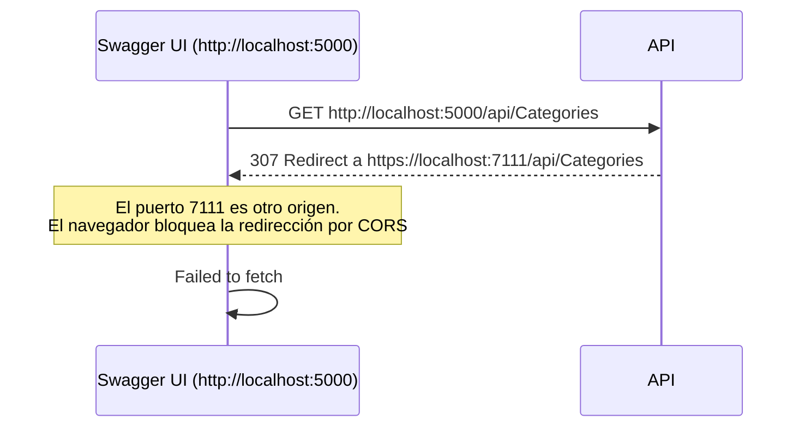
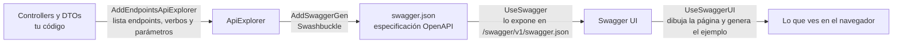

# Configuración del proyecto — launchSettings, HTTPS y Swagger

## ¿Qué es `launchSettings.json`?

Define **cómo se arranca la app en tu máquina**: URLs, puertos, variables de entorno y qué abre el navegador.

| | |
|---|---|
| Dónde vive | `Properties/launchSettings.json` |
| Para qué sirve | **Solo desarrollo local**. No se despliega a producción. |
| Equivalente en .NET Framework 4.8 | Propiedades del proyecto → pestaña Web (IIS Express, Project URL) |

Cada entrada de `profiles` es un perfil que eliges al ejecutar (`http`, `https`, `IIS Express`).

---

## Caso real: "Failed to fetch" en Swagger

### Síntoma

Swagger UI carga, pero al darle Execute a `GET /api/Categories`:

```
Failed to fetch.
Possible Reasons: CORS / Network Failure / URL scheme must be "http" or "https" for CORS request.
```

### Causa

El perfil `https` escuchaba en dos puertos, pero abría Swagger por el HTTP:

```json
"https": {
  "launchUrl": "http://localhost:5000/swagger/index.html",
  "applicationUrl": "https://localhost:7111;http://localhost:5000"
}
```

Y `Program.cs` tiene `app.UseHttpsRedirection()`.



El mensaje "Possible Reasons: CORS" es genérico del navegador. Aquí era la **redirección** a otro origen, no un problema del controller ni de la BD. Si fuera la BD, verías un 500, no un "Failed to fetch".

### Cómo comprobarlo

| Prueba | Qué esperas |
|---|---|
| Abrir `http://localhost:5000/api/Categories` en una pestaña | Si te redirige a `https://localhost:7111/...`, confirmado |
| DevTools (F12) → Network en el request fallido | Se ve el 307 |

### Arreglo: `launchUrl` relativo

```json
"launchUrl": "swagger"
```

Un `launchUrl` relativo se une con la **primera** URL de `applicationUrl`, así que cada perfil abre con su propio esquema:

| Perfil | `applicationUrl` | `launchUrl` | Abre |
|---|---|---|---|
| `http` | `http://localhost:5000` | `swagger` | `http://localhost:5000/swagger` |
| `https` | `https://localhost:7111;http://localhost:5000` | `swagger` | `https://localhost:7111/swagger` |

**Por qué el perfil `http` funcionaba:** como solo escucha en HTTP y no tiene puerto HTTPS configurado, el middleware no sabe a dónde redirigir y no redirige.

---

## Buenas prácticas

| Qué | Por qué |
|---|---|
| Trabajar con el perfil `https` | En producción habrá HTTPS. Así pruebas con la redirección activa, como será en real. |
| **No** quitar `UseHttpsRedirection` para "arreglar" esto | Tapas el síntoma y pierdes el comportamiento que quieres en producción. |
| Usar `launchUrl` relativo | No repites puertos ni mezclas esquemas. |
| Quitar el perfil `IIS Express` si no se usa | Es resto de la plantilla y apunta a `weatherforecast`, que ya no existe. |

### Certificado de desarrollo

Si el navegador se queja del certificado HTTPS local:

```
dotnet dev-certs https --trust
```

Reinicia el navegador después.

---

## Cómo Swagger genera la documentación y el JSON de ejemplo

Swagger no lee tus comentarios ni adivina: **inspecciona tu código por reflexión** al arrancar la app.



| Línea de `Program.cs` | Qué hace |
|---|---|
| `AddEndpointsApiExplorer()` | Descubre los endpoints: ruta, verbo, parámetros y tipos. |
| `AddSwaggerGen()` | Convierte esa información en un documento OpenAPI (`swagger.json`). |
| `UseSwagger()` | Publica ese JSON en `/swagger/v1/swagger.json`. |
| `UseSwaggerUI()` | Sirve la página interactiva que lo lee. |

### De dónde sale el JSON de ejemplo del POST

1. El método recibe `[FromBody] CreateProductDto`, así que Swashbuckle usa **ese tipo** como esquema del body.
2. Recorre las propiedades públicas del DTO y anota el tipo de cada una en el `swagger.json`.
3. Swagger UI genera el ejemplo a partir de ese esquema con valores de relleno **según el tipo**. No salen de tu BD ni de tus datos.

| Tipo en el DTO | Valor de ejemplo |
|---|---|
| `string` | `"string"` |
| `int` / `decimal` | `0` |
| `DateTime` | la fecha y hora actual |
| `bool` | `true` |

Los nombres salen en `camelCase` (`imgUrl`, `categoryId`) porque `System.Text.Json` usa esa convención por defecto en APIs web, aunque en C# sean `ImgUrl` y `CategoryId`.

**Analogía:** es como un formulario en blanco generado a partir del molde del DTO. Cada campo del molde es un renglón, y el tipo decide qué texto de ejemplo va dentro.

### Consecuencias prácticas

| Si cambias… | Se refleja en Swagger |
|---|---|
| Una propiedad del DTO | Cambia el ejemplo y el esquema |
| `[Required]`, `[Range]` | Aparecen como restricciones en el esquema |
| `[ProducesResponseType(...)]` | Aparecen los códigos de respuesta |
| `IActionResult` en lugar de `ActionResult<T>` | El 200 sale sin esquema (Swagger no sabe qué devuelves) |

Para ver el documento crudo: `https://localhost:7111/swagger/v1/swagger.json`.

⚠️ Si un DTO trae campos que el cliente no debería mandar (por ejemplo `UpdateDate` en `CreateProductDto`), Swagger los muestra como si fueran válidos. Lo que ves en el ejemplo es exactamente lo que tu API acepta.

---

## ⚠️ `Program.cs` no está en UTF-8

Los comentarios con acentos (`conexión`, `documentación`) se ven como `�` porque el archivo está guardado en una codificación antigua (Windows-1252). No afecta la ejecución, pero conviene guardarlo como **UTF-8** para evitar problemas al editarlo con herramientas modernas.
