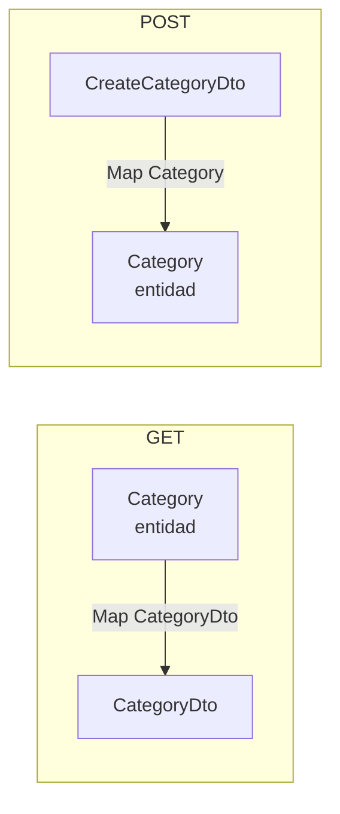

# DTOs y AutoMapper

## Por qué separar Entidad de DTO (aunque tengan las mismas propiedades)

| | Entidad (`Category`) | DTO (`CategoryDto`) |
|---|---|---|
| Representa | Cómo se guarda en la BD | Cómo se expone al cliente/API |
| Quién la controla | El esquema de la base de datos | Tú, explícitamente |

**Analogía:** la entidad es la cocina de un restaurante (ingredientes internos, procesos, cambios de proveedor); el DTO es el menú (lo curado y estable que el cliente ve).

### Qué pasa si NO se separan (se expone la entidad directo)

```csharp
[HttpGet]
public IActionResult GetCategories() => Ok(_db.Categories.ToList()); // ⚠️
```

1. **Expone datos que no deberían ser públicos** (notas internas, IDs de auditoría, etc.).
2. **Rompe el contrato de la API sin darte cuenta** — si el equipo agrega una relación nueva a la entidad, el endpoint empieza a devolver datos extra sin que nadie lo decidiera explícitamente.
3. **Riesgo de over-posting** — en un POST con la entidad como parámetro directo, alguien podría mandar en el JSON campos que no debería poder setear (ej. un `Id` o un campo sensible).

**Regla:** siempre separar DTO de entidad en proyectos de API, incluso si hoy son idénticos — es cuestión de tiempo antes de que dejen de serlo.

---

## AutoMapper

> Nota: AutoMapper pasó a licencia de paga para uso comercial (a partir de cierta versión). Si el proyecto no lo sigue usando, alternativas: mapeo manual (constructor/método de extensión), o librerías gratuitas como **Mapster**. La lógica de "por qué separar DTO/entidad" de este documento sigue aplicando igual, sin importar la herramienta de mapeo.

### `CreateMap` y `.ReverseMap()`

```csharp
public class CategoryProfile : Profile
{
    public CategoryProfile()
    {
        CreateMap<Category, CategoryDto>().ReverseMap();
        CreateMap<CreateCategoryDto, Category>().ReverseMap();
    }
}
```

- `CreateMap<A, B>()` → enseña a convertir `A → B`.
- `.ReverseMap()` → además genera automáticamente `B → A`, sin tener que declararlo aparte.

**Analogía:** `Profile` es un traductor bilingüe. `CreateMap<A, B>()` es enseñarle "cuando te hablen en A, tradúcelo a B". `.ReverseMap()` es "y también al revés".

⚠️ Importante: si ya existe `CreateMap<CreateCategoryDto, Category>()`, esa dirección **ya funciona sola**, sin necesitar el `.ReverseMap()`. El `.ReverseMap()` solo agrega la dirección contraria (`Category → CreateCategoryDto`), que puede no usarse en el código actual — se deja "por si acaso" se necesita después.

### Dirección del mapeo según el flujo (regla clave)

| Endpoint | Dirección | Por qué |
|---|---|---|
| GET (`GetCategory`) | `Category → CategoryDto` | Los datos **salen** de la API hacia el cliente |
| POST (`CreateCategory`) | `CreateCategoryDto → Category` | Los datos **entran** desde el cliente, hay que convertirlos a entidad para guardar con EF Core |

```csharp
// Sintaxis: Map<TIPO_DESTINO>(objetoOrigen)
_mapper.Map<CategoryDto>(category);        // GET:  entidad -> DTO
_mapper.Map<Category>(createCategoryDto);  // POST: DTO -> entidad
```



### Por qué existen DTOs distintos para leer y crear (`CategoryDto` vs `CreateCategoryDto`)

No todos los DTOs tienen las mismas propiedades:

| DTO | Propósito | Diferencia típica |
|---|---|---|
| `CategoryDto` | Mostrar datos (GET) | Incluye `Id`, quizás fecha de creación |
| `CreateCategoryDto` | Recibir datos para crear (POST) | Sin `Id` (lo genera la BD), sin campos generados por el sistema |

---

## Dos mapeos distintos: no confundirlos

Si el repositorio ya trae `Product`, ¿por qué `ProductDto`? Porque "mapeo" son dos cosas:

| Mapeo | Entre qué | Quién lo hace |
|---|---|---|
| **ORM** | Tabla `Products` en SQL ↔ clase `Product` | EF Core |
| **Objeto a objeto** | `Product` ↔ `ProductDto` | AutoMapper |

`Product` es la fila de la BD. `ProductDto` es lo que decides mostrarle al cliente de la API.

### Riesgos extra de exponer `Product` directo

| Riesgo | Ejemplo en el e-commerce |
|---|---|
| Fuga de datos al crecer el modelo | Hoy `Product` no tiene datos sensibles. Mañana agregas `Cost` o `SupplierId` y se filtran sin que nadie lo decida. |
| Navegación | `Product.Category` es una entidad completa. Con `Include` viaja anidada, y con relaciones bidireccionales el serializador puede caer en **referencias circulares**. |
| Over-posting | Si recibes `Product` en un POST, el cliente puede mandar `ProductId` o `CreationDate`. Por eso existe `CreateProductDto` sin esos campos. |
| Acoplamiento al esquema | Renombrar una columna rompe el contrato con los clientes. |

Hoy `Product` y `ProductDto` son casi idénticos. Es normal: el patrón se justifica por lo que pasa cuando el modelo crece.

### Mapear una colección completa

```csharp
// Con foreach
var productsDto = new List<ProductDto>();
foreach (var product in products)
    productsDto.Add(_mapper.Map<ProductDto>(product));

// Equivalente, una sola línea
var productsDto = _mapper.Map<List<ProductDto>>(products);
```

Mismo resultado. Más adelante, `ProjectTo<ProductDto>` permite que el SQL traiga solo las columnas del DTO (tema de `Include` y N+1).

### ⚠️ `Product.Category` es `required`

`CreateProductDto` solo trae `CategoryId`, no el objeto `Category`. AutoMapper no puede llenar un `required Category`, así que mapear `CreateProductDto → Product` falla o deja el producto inválido. La navegación no debería ser `required` si el DTO solo trae la FK.

---

## El parámetro del método define el body (y Swagger)

```csharp
public IActionResult CreateProduct([FromBody] CreateProductDto createProductDto)
```

| Parte | Para qué sirve |
|---|---|
| `CreateProductDto` | Su tipo define qué campos acepta la API. Swagger arma el esquema y el ejemplo con sus propiedades públicas. |
| `[FromBody]` | Indica que se llena con el JSON del body. |
| `createProductDto` (nombre) | Solo es el nombre de la variable. No afecta al JSON ni a Swagger. |

Si agregas o quitas una propiedad del DTO, cambia lo que la API acepta. Ver `configuracion-proyecto.md` para el detalle de cómo Swagger lo genera.

### ⚠️ La validación va en el DTO, no en la entidad

La validación automática de `[ApiController]` se aplica al **parámetro que recibe el método**, o sea al DTO. Si las anotaciones solo están en la entidad, no se ejecutan en la entrada.

Con `CreateProductDto` sin anotaciones, estos requests pasan la validación:

| Request | Resultado |
|---|---|
| `name: ""` | ✅ Pasa |
| `price: -50` | ✅ Pasa |
| `stock: -3` | ✅ Pasa |

Los `[Required]` y `[Range]` de `Product` no protegen la entrada de la API, porque el cliente nunca manda un `Product`. Hay que repetirlos en `CreateProductDto`.

### Campo calculado desde una relación: `CategoryName`

```csharp
CreateMap<Product, ProductDto>()
    .ForMember(dest => dest.CategoryName, opt => opt.MapFrom(src => src.Category.Name))
    .ReverseMap();
```

`ForMember` + `MapFrom` sirve cuando el destino no tiene una propiedad con el mismo nombre en el origen: aquí `CategoryName` sale de `Category.Name`.

⚠️ Para que `Category` tenga datos, la consulta debe traerla con `Include(p => p.Category)`. Sin `Include`, `Category` es `null` y `CategoryName` queda vacío **sin ningún error**.

| Dónde se carga el producto | ¿Trae `Category`? |
|---|---|
| `GetProduct` y `GetProducts` | ✅ Con `Include` |
| `GetProductsForCategory`, `SearchProduct` | ❌ Sin `Include`, el `CategoryName` sale vacío |
| Producto recién creado (`CreateProduct`) | ❌ No se cargó la relación; `CategoryName` sale vacío en la respuesta del POST |

Esto es el inicio del tema `Include` / `ThenInclude` y el problema N+1 (pendiente de repasar).

### Campos que el cliente no debería poder mandar

`CreateProductDto` incluye `UpdateDate`, así que Swagger lo muestra y la API lo acepta, aunque el repositorio lo sobrescribe. Un DTO de entrada solo debería tener los campos que el cliente realmente decide.
